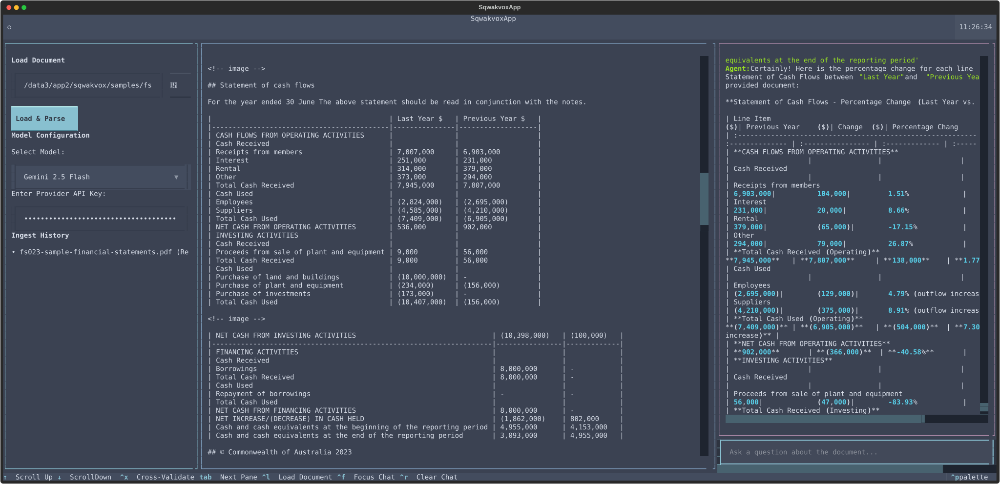
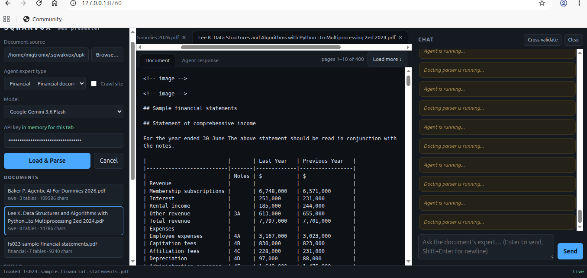
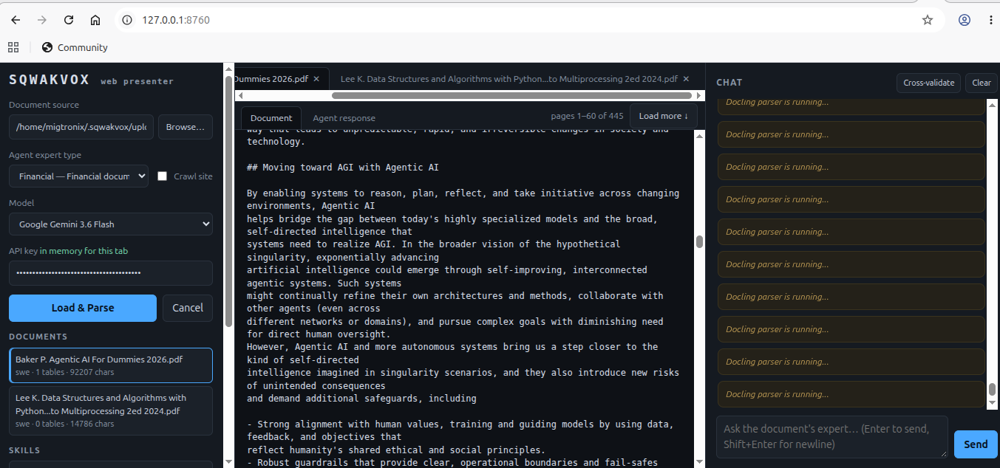
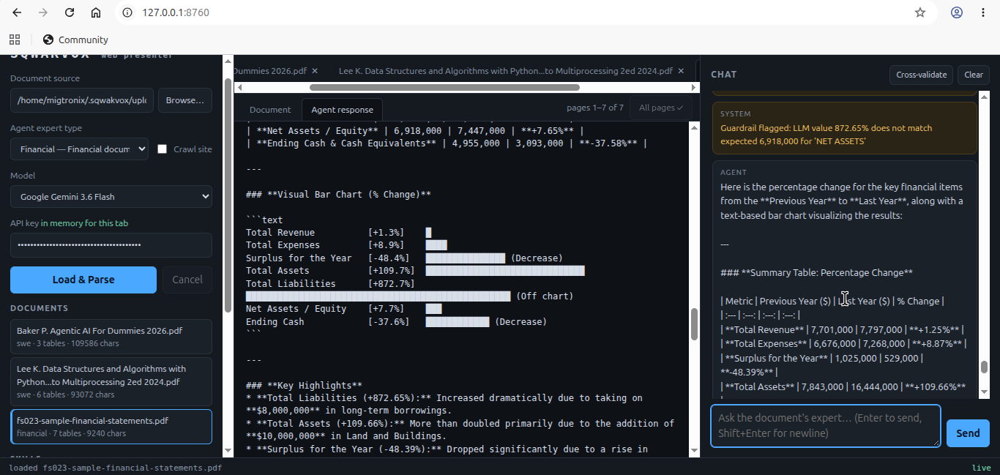

# Sqwakvox — Local AI Multi-Document Assistant

```
███████╗ ██████╗ ██╗    ██╗ █████╗ ██╗  ██╗██╗   ██╗ ██████╗ ██╗  ██╗
██╔════╝██╔═══██╗██║    ██║██╔══██╗██║ ██╔╝██║   ██║██╔═══██╗╚██╗██╔╝
███████╗██║   ██║██║ █╗ ██║███████║█████╔╝ ██║   ██║██║   ██║ ╚███╔╝ 
╚════██║██║▄▄ ██║██║███╗██║██╔══██║██╔═██╗ ╚██╗ ██╔╝██║   ██║ ██╔██╗ 
███████║╚██████╔╝╚███╔███╔╝██║  ██║██║  ██╗ ╚████╔╝ ╚██████╔╝██╔╝ ██╗
╚══════╝ ╚══▀▀═╝  ╚══╝╚══╝ ╚═╝  ╚═╝╚═╝  ╚═╝  ╚═══╝   ╚═════╝ ╚═╝  ╚═╝
```

[](https://python.org)
[](LICENSE)

Sqwakvox is a multi-document assistant application with terminal and web interfaces. It uses IBM Docling to read documents such as PDFs, EPUBs, and web pages. It connects to language models through LangChain and Mozilla `any-llm`. The application enforces domain-specific guardrails, document rendering, and tools.

- **Financial** — Tables, sparkline trends, numerical cross-validation, and calculation tools.
- **Software Engineering (SWE)** — Library documentation and engineering books. It builds table-of-contents and code-block indexes. It creates reusable skill files during chat.





## Features

- **3-Pane TUI**: The terminal interface provides a sidebar, a document render pane, and a chat log.
- **Web Presenter**: The browser interface provides the same 3-pane layout. It displays live progress through Server-Sent Events (SSE). 24 MCP tools expose the presenter API.
- **Multiple expert types**: Select the agent expert type when you load a document. Each document tab keeps its own domain rules, prompts, and tools.
- **Docling Integration**: The application parses local PDF, EPUB, and Markdown files and remote URLs. It can crawl documentation websites for multi-page documentation.
- **Multi-Model Support**: The application connects to OpenAI, Anthropic, Mistral, and Gemini models.
- **Input Guardrails**: Mozilla `any-guardrail` blocks prompt injection attacks before queries reach the model.
- **PII Redaction**: The system redacts Social Security numbers, credit cards, bank accounts, and email addresses.
- **Financial Cross-Validation**: The rule engine extracts numeric table values and verifies calculated results.
- **SWE skills**: The SWE assistant creates, reads, and updates reusable `SKILL.md` files under `./skills/swe/<name>/` through skills MCP tools.
- **Chunked retrieval**: Large SWE documents index into SQLite FTS5 chunks. The agent searches chunks through the `retrieval` MCP tool. The application warns about prompt injection text in ingested documents.
- **OpenTelemetry Instrumentation**: The system records traces and metrics for document processing, agent execution, and tool calls.
- **Unicode Table Rendering**: The application displays double borders, automatic column alignment, and numeric sparklines.
- **Audit Logging**: The application writes events to an append-only JSONL audit log.

## Architecture

Sqwakvox uses a model-view-presenter (MVP) architecture. Celery decouples the views from background execution. The Textual TUI and the web interface submit tasks through the presenter. A worker process runs document ingestion, post-processing, and agent execution.

The domain registry (`sqwakvox/domains/`) defines document domains. A `DocumentDomain` profile specifies prompts, ingestion plans, guardrails, renderers, and tools. To add a new assistant, register a new domain in the registry. You do not need to change core application code.

```
┌─────────────────────────────────────────────────────────────┐
│                    View — Textual TUI (app.py)               │
│  3-pane interface: sidebar / document render / chat log      │
└──────────────────────────┬──────────────────────────────────┘
                           │ submit + poll (AsyncResult)
                           ▼
┌─────────────────────────────────────────────────────────────┐
│            Presenter (presenter.py)                          │
│  async facade: TaskHandle, callbacks, revoke, wait()         │
└──────────────────────────┬──────────────────────────────────┘
                           │ Redis broker + result backend
                           ▼
┌─────────────────────────────────────────────────────────────┐
│     Backend — Celery workers (run_worker.py)                 │
│  ┌───────────────────────────┐   ┌────────────────────────┐ │
│  │ sqwakvox.docling (×1)     │   │ sqwakvox.doc<N> (×tabs)│ │
│  │ Docling conversion only   │   │ data store / agent     │ │
│  │ → AppController           │   │ → AppController        │ │
│  └───────────────────────────┘   └────────────────────────┘ │
└─────────────────────────────────────────────────────────────┘
```

`DocSession` (`sqwakvox/doc_session.py`) manages session state without widget dependencies. It controls the document registry, worker queues, chat history, background jobs, and event bus. Both the TUI and the [Web Presenter](#web-presenter) connect to this session.

The session exposes its complete API as MCP tools (`sqwakvox/mcp_presenter.py`). The browser, the TUI, and external MCP clients use this single interface to interact with the session.

### Running the backend

The application automatically manages Celery workers:

- **One shared Docling worker** on the `sqwakvox.docling` queue:
  All document tabs share one worker for conversion. This limits memory use because Docling models load once for the machine.
- **One agent worker per document tab** on dedicated queues (`sqwakvox.doc0`, `sqwakvox.doc1`, ...):
  Each tab processes queries in isolation. A long query on one document does not block another tab.

The application stops workers when the process exits. The system writes worker logs to `./sqwakvox_workers/`.

If you want to start workers manually, set `SQWAKVOX_MANAGED_WORKERS=0`:

```bash
# Terminal 1 — Celery worker
uv run python -m sqwakvox.run_worker

# Terminal 2 — TUI (managed workers disabled)
SQWAKVOX_MANAGED_WORKERS=0 uv run sqwakvox
```

The broker and result backend default to `redis://localhost:6379`. You can change these addresses with `SQWAKVOX_CELERY_BROKER` and `SQWAKVOX_CELERY_BACKEND`. For local testing without Redis, set `SQWAKVOX_CELERY_EAGER=1` to run tasks in the main process.

## Installation

Install the package with pip:

```bash
pip install sqwakvox
# or from source:
pip install -e .
```

This application requires Python 3.12 or higher.

## Usage

Run the terminal interface:

```bash
sqwakvox
```

Start the web interface:

```bash
redis-server &
sqwakvox-web
```

Open `http://127.0.0.1:8760` in your web browser.

Follow these steps to analyze a document:

1. Enter a file path or URL in the source input field, or click **Browse**.
2. Select the **Agent Expert Type**: *Financial* or *Software Engineering*.
3. Select a model provider from the dropdown list.
4. Enter your API key for the selected provider.
5. Click **Load & Parse** to extract text, tables, and document layout.
6. Enter a question in the chat input.

### Document assistants (domains)

Each open document uses the selected expert type. You can open multiple documents with different domains at the same time. The domain controls the system prompt, guardrails, document rendering, and active MCP tools.

| Domain | Supported Sources | Features |
|---|---|---|
| Financial | PDF, tables | Math cross-validation, sparklines, calculation tools |
| SWE | PDF, EPUB, documentation URLs, Markdown | Table of contents, code-block index, prompt injection scan, secret redaction, skills, chunked retrieval |

#### SWE skills

The SWE assistant can create reusable skills during chat. Ask the agent to save a skill. The assistant uses the skills MCP server to create `SKILL.md` files with YAML frontmatter. It saves files in `./skills/swe/<skill-name>/`. Saved skills appear in the sidebar **Skills** section. Any tool that supports the skill format can use these files. Set `SQWAKVOX_SKILLS_DIR` to change the destination directory.

#### External Agent Integration (MCP Gateway)

You can connect external AI agents to Sqwakvox. External agents include Hermes, Claude Code, Cursor, and Antigravity. External agents use the MCP gateway to inspect open documents, submit questions, and search SWE document chunks.

Start the gateway:

```bash
uv run python -m sqwakvox.mcp_gateway
```

Example configuration for Hermes (`~/.hermes/config.yaml`):

```yaml
mcp_servers:
  sqwakvox:
    command: /home/migtronix/app2/sqwakvox/.venv/bin/python
    args:
      - -m
      - sqwakvox.mcp_gateway
    env:
      SQWAKVOX_CELERY_BROKER: redis://localhost:6379/0
      PYTHONPATH: /home/migtronix/app2/sqwakvox/src
    enabled: true
    timeout: 180
```

##### Gateway & Sibling MCP Security Settings

- **Stdio transport**: The gateway runs over stdio only (`uv run python -m sqwakvox.mcp_gateway`).
- **Worker-side API keys**: API keys do not cross the Celery broker. Worker processes resolve their own provider keys from the worker environment.
- `SQWAKVOX_MCP_QUERY_RPM`: In-process rate limit for `sqwakvox_query` (default: 60 RPM).
- `SQWAKVOX_MCP_ALLOW_HTTP=1` and `SQWAKVOX_MCP_HTTP_TOKEN=<token>`: Required if running sibling servers (`calc`, `skills`, `retrieval`) or the presenter server over SSE or HTTP transport.
- `SQWAKVOX_MCP_READ_ONLY=1`: Enforces read-only mode on the skills server (blocks `create_skill`, `update_skill`, `delete_skill`).

## Web Presenter

The browser interface is a second view of the same session that the TUI drives. Start the web server:

```bash
redis-server &
uv run sqwakvox-web          # http://127.0.0.1:8760
```

The web interface mirrors the three-pane layout of the TUI:

- **Sidebar**: Enter document paths or URLs. You can drag and drop local files into the input field. Select the expert domain, enable site crawling, choose a language model, and enter API keys. The sidebar also lists open documents, active skills, and MCP servers.
- **Document Viewer**: Switch between open documents with document tabs. Toggle between the **Document** view and the **Agent response** view. Use the **Load more** button for incremental paging of large documents.
- **Chat Log**: Review conversation history with live status updates. Click **Cross-validate** to verify table numbers. Click **Clear** to clear chat messages. Press `Enter` to send a message, or `Shift+Enter` to insert a newline.
- **MCP Tool Console**: Press **F2** to open the tool console dialog. The browser creates input forms dynamically from `/api/tools` schemas.





### One presenter, many views

Every action in both views uses the same code path:

```
                 ┌───────────────────────────────┐
                 │  DocSession (doc_session.py)  │
                 │  documents · chat · jobs ·    │
                 │  events · MCP configs         │
                 └───────────────┬───────────────┘
                                 │
                    ┌────────────┴────────────┐
                    │ Presenter → Celery bus  │
                    └────────────┬────────────┘
                                 │
        ┌────────────────────────┼────────────────────────┐
        ▼                        ▼                        ▼
  Textual TUI            MCP presenter server        Web presenter
  (app.py)          (mcp_presenter.py, 24 tools)   (web_presenter.py)
                                                  calls the MCP tools
                                                  in-process + SSE events
```

`DocSession` does not hold widget references. It runs a private asyncio loop. Textual workers, MCP stdio threads, and ASGI worker threads can drive `DocSession`.

When you add a tool to `sqwakvox_presenter_*`, the tool becomes available in the browser automatically. The web interface creates forms from JSON schemas at `/api/tools`.

### Presenter MCP tools

The presenter server publishes 24 tools for the session:

| Area | Tools |
|---|---|
| Status | `status`, `list_domains`, `list_models`, `jobs`, `events` |
| Documents | `open_document` (`_sync`), `activate_document`, `close_document`, `document`, `list_documents`, `load_more` |
| Analysis | `cross_validate` (`_async`), `data_store` |
| Chat | `ask` (`_sync`), `chat`, `clear_chat` |
| Skills & retrieval | `list_skills`, `search_chunks`, `indexed_documents` |

Long operations return a `job_id`. You can collect the result with `wait_job`, or stop the operation with `cancel`. You can follow progress by polling `events` with the `seq` cursor. The `*_sync` tools block until execution completes.

Run the server over HTTP for external clients (both variables required):

```bash
SQWAKVOX_MCP_ALLOW_HTTP=1 SQWAKVOX_MCP_HTTP_TOKEN=secret \
  uv run python -m sqwakvox.mcp_presenter --transport http --port 8765
```

### Web presenter security

- **Loopback binding**: The server binds to `127.0.0.1` by default. It rejects requests with non-local `Host` headers to prevent DNS-rebinding attacks.
- **Token authentication**: When you set `SQWAKVOX_WEB_TOKEN`, all `/api/*` endpoints require a Bearer token. The browser stores this token in session storage. If you bind to a non-loopback address without a token, the server generates a random token.
- **`--allow-remote`**: This flag disables the local `Host` header check for reverse proxy configurations.
- **`--no-token`**: This flag disables authentication for local testing.
- **In-memory API keys**: API keys stay in the browser tab. The browser sends keys per request and does not write them to disk. Workers resolve keys from the environment.

Available web endpoints: `GET /`, `GET /healthz`, `GET /api/tools`, `POST /api/call`, `GET /api/events` (SSE).

### Keybindings

| Key | Action |
|-----|--------|
| `q` | Quit |
| `Ctrl+L` | Focus document source input |
| `Ctrl+F` | Focus chat input |
| `Ctrl+R` | Clear chat log |
| `Tab` | Cycle through panes (source → render → chat) |
| `Up/Down` | Scroll focused pane |
| `Ctrl+X` | Run numerical cross-validation on loaded tables |

In the web interface: `Enter` sends a chat message, `Shift+Enter` adds a newline, and `F2` opens the MCP tool console.

## Configuration

You enter API keys in the sidebar at runtime. The application does not store your keys.

You can set these environment variables instead of entering keys in the sidebar:
- `OPENAI_API_KEY`
- `ANTHROPIC_API_KEY`
- `MISTRAL_API_KEY`
- `GEMINI_API_KEY`

## Guardrails & Safety

1. **Prompt Injection**: `any-guardrail` inspects every user query before the model receives the text.
2. **PII Redaction**: The redactor strips Social Security numbers, credit card numbers, IBANs, and email addresses from user queries and model responses.
3. **Numerical Cross-Validation**: The `FinancialRuleEngine` extracts labelled numbers from document tables and verifies model calculations.
4. **Audit Logging**: The application writes timestamped logs to `~/.gemini/antigravity/sqwakvox/audit_log.jsonl`.

## OpenTelemetry & Performance Monitoring

Sqwakvox records OpenTelemetry traces and performance metrics.

### Traces & Spans

- `sqwakvox.document.convert`: Measures document parsing latency and file size.
- `sqwakvox.agent.execute`: Tracks agent query latency, execution duration, and prompt length.
- `sqwakvox.guardrail.validate_prompt`: Records prompt validation latency and results.
- `sqwakvox.guardrail.redact_pii`: Records PII redaction duration and detected items.
- `sqwakvox.cross_validate`: Measures table column sum validation time.
- `sqwakvox.mcp_tool.<tool_name>`: Records execution time and status for MCP tools.

### Metrics

- `sqwakvox.document.ingest.duration`
- `sqwakvox.document.ingest.count`
- `sqwakvox.agent.execution.duration`
- `sqwakvox.agent.execution.count`
- `sqwakvox.guardrail.duration`
- `sqwakvox.guardrail.violations.count`
- `sqwakvox.mcp.tool.duration`
- `sqwakvox.mcp.tool.count`
- `sqwakvox.active_documents.count`

### Telemetry Configuration

Configure telemetry with environment variables:

```bash
# Enable or disable telemetry (default: true)
export SQWAKVOX_TELEMETRY_ENABLED=true

# Select exporter: otlp, file, console, or none
export SQWAKVOX_TELEMETRY_EXPORTER=file

# Set path for local JSON lines trace log
export SQWAKVOX_TELEMETRY_FILE=sqwakvox_telemetry.jsonl

# Set OTLP collector endpoint
export OTEL_EXPORTER_OTLP_ENDPOINT="http://localhost:4318"
```

## Build with UV

Build the application package:

```bash
uv sync
uv build
```

## Run with UV

Run the application:

```bash
uv run sqwakvox
```

## Development

Run development commands:

```bash
# Install development dependencies
pip install -e ".[dev]"

# Run code linter
ruff check src/

# Run type checker
mypy src/

# Run tests
pytest
```

## License

MIT — see [LICENSE](LICENSE).

## Author

Miguel de Sousa — [miguel.tronix@gmail.com](mailto:miguel.tronix@gmail.com)
